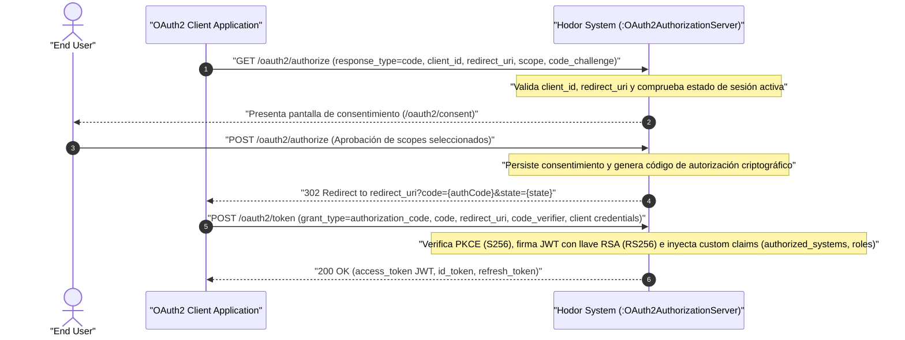
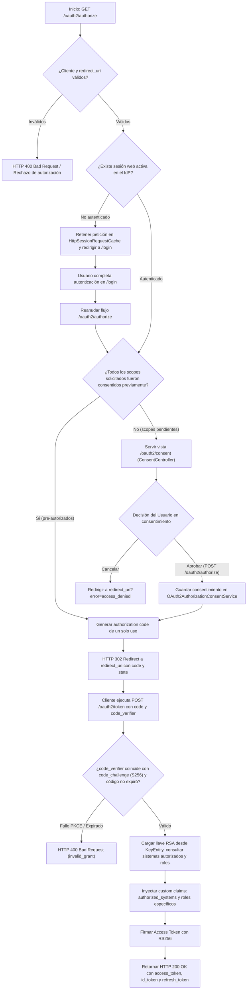

# UC-AUTH-CONSENT: Flujo de Autorización OIDC y Consentimiento de Scopes

> **Trazabilidad SDD:** Derivado de `docs/constitution.md` (Sección A "Naturaleza del Proyecto", Sección C "Desacoplamiento Asimétrico (RS256)" e Invariante "Gestión de Identidad Multi-sistema").

## 1. Ficha de Intención
- **ID:** `UC-AUTH-CONSENT`
- **Actor Principal:** Usuario Final (`End User`) y Aplicación Consumidora OAuth2 (`OAuth2 Client Application`).
- **Disparador:** Solicitud HTTP `GET /oauth2/authorize` iniciada por la aplicación consumidora con parámetros OIDC estándar (`response_type=code`, `client_id`, `redirect_uri`, `scope`, `state`, `code_challenge`, `code_challenge_method=S256`).
- **Precondiciones:**
  - El cliente OAuth2 debe estar registrado en el proveedor de identidad con soporte para el flujo `authorization_code` y validación estricta de PKCE (`requireProofKey=true`).
  - La dirección `redirect_uri` enviada en la solicitud debe coincidir exactamente con una de las URIs configuradas y autorizadas para dicho cliente en `RegisteredClientRepository`.
- **Invariantes de Negocio:**
  - **Autenticación Interactiva Obligatoria:** Si el usuario no cuenta con una sesión web activa en el IdP, el sistema retiene la petición original en la caché de peticiones (`HttpSessionRequestCache`) y redirige al usuario a `/login` (`UC-SESSION-ACTIVE-UI`). Tras autenticarse exitosamente, el flujo de autorización se reanuda de manera automática.
  - **Consentimiento Explícito de Scopes:** Hodor exige consentimiento granular interactivo (`requireAuthorizationConsent=true`). Si existen permisos solicitados que el usuario no ha aprobado previamente, el sistema delega la interacción a [`ConsentController`](file:///home/calevin/Github/Hodor/src/main/java/com/calevin/hodor/infrastructure/ui/controller/ConsentController.java) (`/oauth2/consent`) presentando la plantilla `consent.html`.
  - **Persistencia de Consentimiento:** Los permisos consentidos por el usuario son almacenados en `OAuth2AuthorizationConsentService`, de modo que en solicitudes futuras para el mismo cliente dichos scopes figuren como pre-autorizados.
  - **Seguridad Criptográfica PKCE (RFC 7636):** Toda emisión de tokens por código de autorización requiere la validación del secreto `code_verifier` contra el `code_challenge` (S256) remitido al inicio del flujo.
  - **Enriquecimiento de Claims JWT (RS256):**
    - El token de acceso emitido es firmado asimétricamente con la llave privada RSA persistida en base de datos (`KeyEntity`).
    - El componente `JwtTokenCustomizerConfig` intercepta la generación del token e inyecta los claims de dominio:
      - `authorized_systems`: Lista de todos los identificadores de clientes a los cuales el usuario tiene acceso.
      - `roles`: Consolidación ordenada de las autoridades globales (`ROLE_USER`, `ROLE_ADMIN`) y de los roles específicos asociados al usuario para el cliente solicitante (`userClientRoleRepository`).
    - Las aplicaciones del ecosistema validan el token de manera desacoplada consumiendo las claves públicas en `/.well-known/jwks.json`.

## 2. Diagrama de Interacción del Sistema (SSD)

## 3. Árbol de Decisiones

## 4. Caminos Alternativos y Catálogo de Errores

| Código HTTP / Error | Condición Disparadora | Efecto y Respuesta del Sistema |
| :--- | :--- | :--- |
| `400 Bad Request` (`invalid_request`) | Petición de autorización con parámetros obligatorios ausentes, malformados o `code_challenge` omitido | Rechazo de la solicitud sin continuar el flujo OIDC |
| `400 Bad Request` (`invalid_request`) | La `redirect_uri` no coincide con las URIs autorizadas para el cliente | Detención inmediata del flujo; no se redirige al cliente por seguridad |
| `302 Found` (`access_denied`) | El usuario pulsa Cancelar en la interfaz de consentimiento | Redirección hacia la aplicación cliente con parámetro `error=access_denied` |
| `401 Unauthorized` (`invalid_client`) | Credenciales de cliente (`client_secret`) erróneas en la llamada al endpoint de token | Rechazo con código HTTP 401 Unauthorized sin emitir tokens |
| `400 Bad Request` (`invalid_grant`) | El código de autorización ya fue utilizado, ha expirado o el `code_verifier` de PKCE no concuerda | Rechazo con código HTTP 400 Bad Request e invalidación del intento de canje |

## 5. Postcondiciones y Efectos Secundarios

- **Estado Persistido:**
  - El consentimiento otorgado por el usuario se guarda en la tabla `oauth2_authorization_consent`.
  - El código de autorización emitido, tokens y metadatos del ciclo de vida se registran en la tabla `oauth2_authorization`.
- **Eventos Emitidos:**
  - Eventos de auditoría de Spring Security (`AuthorizationGrantAuthenticationToken`, `OAuth2AccessTokenAuthenticationToken`).
- **Artefactos Criptográficos Emitidos:**
  - `access_token`: Token JWT firmado con RS256 con claims `authorized_systems` y `roles`.
  - `id_token`: Token OIDC con la identidad autenticada (`sub`, `iss`, `aud`).
  - `refresh_token`: Token para renovación rotativa (`reuseRefreshTokens = false`).
- **Auditoría:**
  - Registro en bitácora de emisión de credenciales y trazabilidad en métricas de Actuator.
