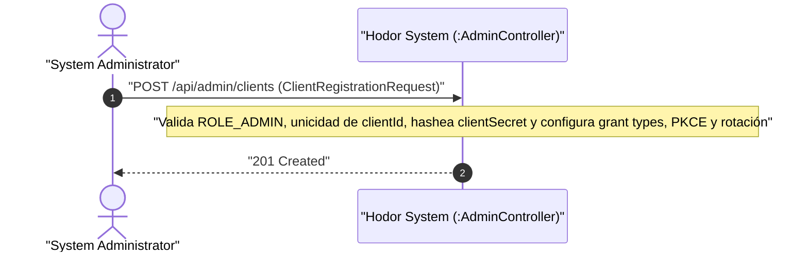
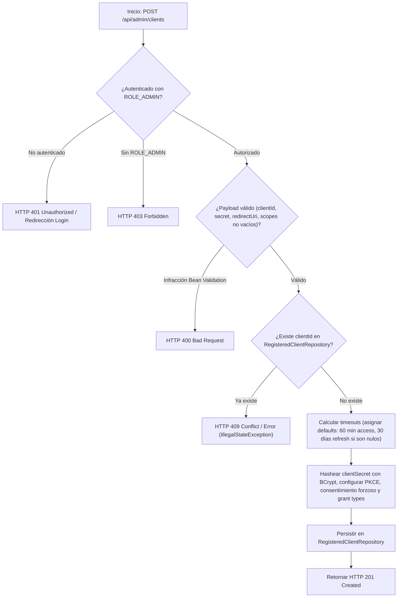

# UC-CLIENT-REGISTER: Registro de Nuevo Cliente OAuth2

> **Trazabilidad SDD:** Derivado de `docs/constitution.md` (Sección C "Invariantes del Dominio", "Desacoplamiento Asimétrico", Sección D "Arquitectura Hexagonal").

## 1. Ficha de Intención
- **ID:** `UC-CLIENT-REGISTER`
- **Actor Principal:** Administrador de Sistemas (`System Administrator` con autoridad `ROLE_ADMIN`).
- **Disparador:** Solicitud HTTP `POST /api/admin/clients` recibida en la API administrativa con payload JSON (`ClientRegistrationRequest`).
- **Precondiciones:**
  - El solicitante debe estar autenticado en el sistema y disponer del rol administrativo `ROLE_ADMIN`.
- **Invariantes de Negocio:**
  - **Unicidad de Identificador:** El `clientId` debe ser único en el catálogo de clientes (`RegisteredClientRepository`).
  - **Protección Criptográfica de Secretos:** El secreto provisto (`clientSecret`) se hashea mediante `PasswordEncoder` (BCrypt) previo a su almacenamiento persistente; nunca se almacena en texto plano.
  - **Configuración de Seguridad por Defecto (RFC 6749 / RFC 7636):**
    - Métodos de autenticación admitidos: `CLIENT_SECRET_BASIC`.
    - Grant Types otorgados: `authorization_code`, `refresh_token` y `client_credentials`.
    - Restricciones OIDC: `requireAuthorizationConsent(true)` y `requireProofKey(true)` (PKCE obligatorio).
    - Gestión de Refresh Tokens: `reuseRefreshTokens(false)` (rotación forzosa de refresh token en cada renovación).
  - **Valores por Defecto de Expiración:**
    - Si no se provee `accessTokenTimeoutMinutes`, se asigna por defecto 60 minutos.
    - Si no se provee `refreshTokenTimeoutDays`, se asigna por defecto 30 días.
  - **Validación Declarativa de Entrada:**
    - `clientId`: Obligatorio, no vacío.
    - `clientSecret`: Obligatorio, no vacío.
    - `redirectUri`: Obligatorio, formato de URI no vacío.
    - `scopes`: Conjunto de permisos no vacío.
    - `postLogoutRedirectUri`: Opcional.

## 2. Diagrama de Interacción del Sistema (SSD)

## 3. Árbol de Decisiones

## 4. Caminos Alternativos y Catálogo de Errores

| Código HTTP / Error | Condición Disparadora | Efecto y Respuesta del Sistema |
| :--- | :--- | :--- |
| `401 Unauthorized` | Petición efectuada sin credenciales válidas o sesión expirada | Rechazo inmediato de la solicitud o redirección a la pantalla de login |
| `403 Forbidden` | Usuario autenticado que carece de la autoridad `ROLE_ADMIN` | Rechazo con código HTTP 403 Forbidden sin consultar la base de datos |
| `400 Bad Request` | Parámetros obligatorios ausentes o colección `scopes` vacía | Rechazo con código HTTP 400 Bad Request detallando los campos inválidos |
| `409 Conflict / Error` | El `clientId` enviado ya se encuentra registrado en el sistema | Lanzamiento de `IllegalStateException` y rechazo para evitar sobreescritura accidental |

## 5. Postcondiciones y Efectos Secundarios

- **Estado Persistido:**
  - Se almacena un nuevo registro en la tabla `oauth2_registered_client` con identificador UUID interno, `clientId`, `clientSecret` hasheado, configuraciones de tokens y permisos asignados.
- **Eventos Emitidos:**
  - Ninguno (operación síncrona transaccional).
- **Auditoría:**
  - Registro en bitácora de la aplicación indicando la registración del cliente OAuth2 y trazabilidad en métricas de Actuator.
