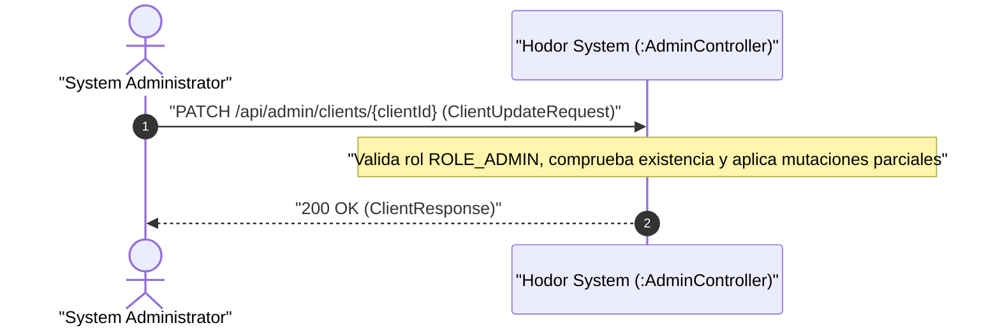
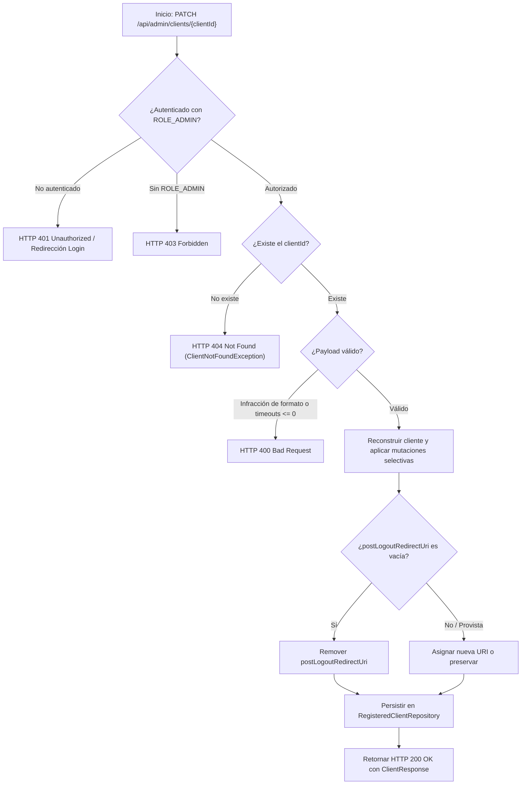

# UC-CLIENT-UPDATE: Actualización de Configuración de Cliente OAuth2

> **Trazabilidad SDD:** Derivado de la spec `specs/001_actualizar_cliente_spec.md` (Requisitos: `RF-01`, `RF-02`, `RF-03`, `RF-04`, `RF-05`, `RF-06`, `RNF-01`, `RNF-02`).

## 1. Ficha de Intención
- **ID:** `UC-CLIENT-UPDATE`
- **Actor Principal:** Administrador de Sistemas (`System Administrator` con autoridad `ROLE_ADMIN`).
- **Disparador:** Solicitud HTTP `PATCH /api/admin/clients/{clientId}` recibida en la API administrativa.
- **Precondiciones:**
  - El solicitante debe estar autenticado en el sistema y disponer del rol administrativo `ROLE_ADMIN`.
  - El cliente OAuth2 identificado por `clientId` debe existir previamente registrado en el repositorio persistente (`RegisteredClientRepository`).
- **Invariantes de Negocio:**
  - **Inmutabilidad de Identidad:** El identificador del cliente (`clientId`) y su ID interno no pueden mutar bajo ninguna circunstancia (`RF-05`).
  - **Preservación y Confidencialidad de Secretos:** El secreto criptográfico preexistente (`clientSecret`) se mantiene inalterado y queda estrictamente excluido del cuerpo de respuesta (`RF-06`).
  - **Semántica de Actualización Parcial:** Los atributos omitidos o nulos en el cuerpo de la petición (`ClientUpdateRequest`) deben conservar sin alteración sus valores preexistentes (`CL-02`).
  - **Reglas de Validación Declarativa:**
    - `redirectUri`: Si está presente, debe cumplir con un formato de URL HTTP o HTTPS válido (`RF-03`).
    - `postLogoutRedirectUri`: Si está presente, debe ser una URL HTTP/HTTPS válida o una cadena vacía `""` destinada a desasociar la URI de post-logout existente (`CL-01`, `RF-03`).
    - `scopes`: Si está presente, no puede ser una colección vacía ni contener elementos en blanco (`RF-03`).
    - `accessTokenTimeoutMinutes` y `refreshTokenTimeoutDays`: Si están presentes, deben ser valores estrictamente positivos (`> 0`, `RF-03`).
  - **Transaccionalidad Atómica:** La mutación debe ejecutarse dentro de una frontera transaccional (`@Transactional`), garantizando atomicidad completa ante errores inesperados (`RNF-02`).

## 2. Diagrama de Interacción del Sistema (SSD)

## 3. Árbol de Decisiones

## 4. Caminos Alternativos y Catálogo de Errores

| Código HTTP / Error | Condición Disparadora | Efecto y Respuesta del Sistema |
| :--- | :--- | :--- |
| `401 Unauthorized` | Solicitud efectuada sin credenciales o con sesión expirada | Denegación inmediata de la solicitud o redirección al formulario de inicio de sesión |
| `403 Forbidden` | Usuario autenticado que carece de la autoridad `ROLE_ADMIN` | Rechazo con código HTTP 403 Forbidden sin consultar ni modificar el repositorio |
| `404 Not Found` | El `clientId` enviado en la ruta no corresponde a ningún cliente registrado | `ClientNotFoundException` con HTTP 404 y mensaje explicativo |
| `400 Bad Request` | Payload con errores de validación (`redirectUri` inválido, timeouts no positivos o `scopes` vacío) | Rechazo con HTTP 400 Bad Request detallando los campos no conformes |

## 5. Postcondiciones y Efectos Secundarios

- **Estado Persistido:**
  - Las modificaciones de los atributos provistos (`redirectUri`, `postLogoutRedirectUri`, `scopes`, `tokenSettings`) se guardan de forma permanente en la base de datos a través de `RegisteredClientRepository`.
  - El `clientSecret` permanece intacto con su valor hash previo.
  - Si `postLogoutRedirectUri` fue provisto con cadena vacía `""`, la colección de URIs de post-cierre de sesión queda vacía.
- **Eventos Emitidos:**
  - No aplica (operación transaccional síncrona en base de datos).
- **Auditoría:**
  - Registro en bitácora estándar de Spring Security y métricas de invocación de endpoints administrativos expuestas en Actuator.
