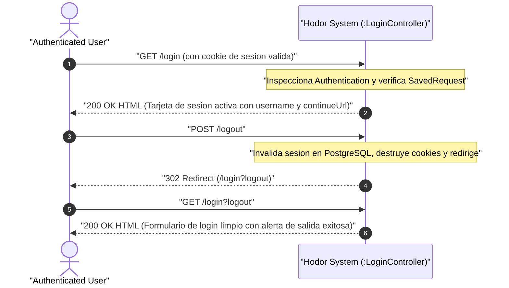
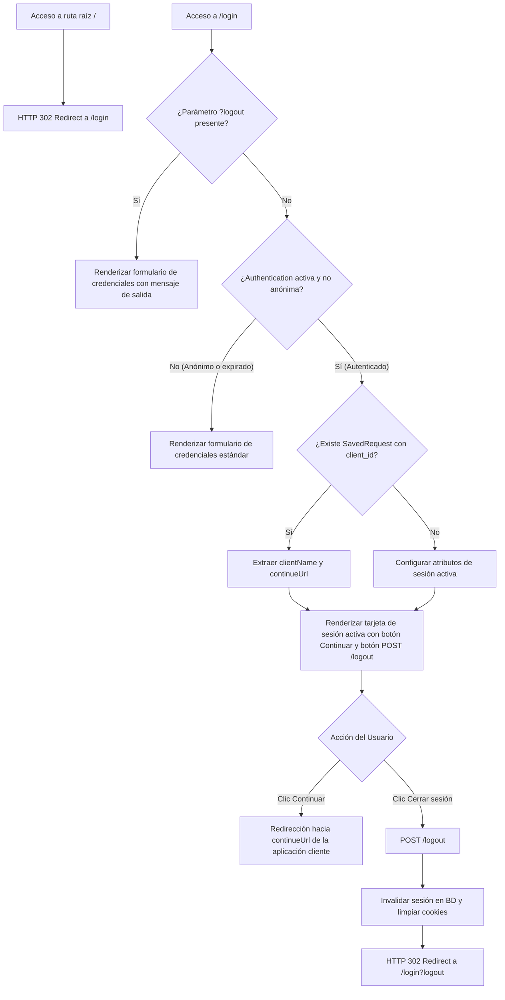

# UC-SESSION-ACTIVE-UI: Gestión y Detección de Sesión Activa en la Interfaz de Usuario

> **Trazabilidad SDD:** Derivado de la spec `specs/002_gestion_sesion_activa_ui_spec.md` (Requisitos: `RF-01`, `RF-02`, `RF-03`, `RF-04`, `RF-05`, `RF-06`, `RF-07`, `RNF-01`, `RNF-02`, `RNF-03`).

## 1. Ficha de Intención
- **ID:** `UC-SESSION-ACTIVE-UI`
- **Actor Principal:** Usuario Final (`End User`), operando bajo el rol de `Authenticated User` (con sesión web activa) o `Anonymous User` (sin credenciales válidas o sesión expirada).
- **Disparador:**
  - Solicitud HTTP `GET /login` o `GET /` desde el navegador.
  - Envío del formulario de salida HTTP `POST /logout`.
- **Precondiciones:**
  - El servicio Hodor debe estar en ejecución con el contexto de Spring Security y la persistencia de sesiones en Spring Session JDBC operativos.
  - Para renderizar la vista de sesión conectada, el contexto `Authentication` de Spring Security debe ser no nulo, autenticado y diferente de `AnonymousAuthenticationToken`.
- **Invariantes de Negocio:**
  - **Bifurcación Declarativa de Vista:**
    - Si existe una sesión activa y no se solicita `?logout`, el sistema presenta la tarjeta de sesión activa con el identificador del usuario (`username`) y oculta por completo los campos de captura de credenciales (`RF-01`).
    - Si el usuario es anónimo o la petición incluye `?logout`, se renderiza exclusivamente el formulario estándar de credenciales (`RF-04`, `CL-02`).
  - **Cierre de Sesión Seguro y No Redundante:**
    - El cierre de sesión se canaliza única y estrictamente mediante el método HTTP POST hacia `/logout`, previniendo invocaciones automáticas indebidas por prefetching de navegadores (`RF-02`, `RNF-01`).
    - Quedan prohibidos controles duplicados (como botones de 'iniciar sesión con otra cuenta') que produzcan el mismo efecto de cierre de sesión en el modelo de sesión única (`RF-02`, `RNF-03`).
  - **Normalización Canónica de Raíz (`/`):**
    - Todo acceso a la ruta raíz `/` responde con una redirección HTTP 302 hacia `/login` tanto para usuarios anónimos como autenticados (`RF-05`, `RF-06`).
  - **Continuidad de Flujo OAuth2 (`SavedRequest`):**
    - Si existe una solicitud de autorización retenida en sesión (`HttpSessionRequestCache`), el sistema extrae el identificador de cliente (`client_id`) y su URL de retorno (`continueUrl`), presentando un botón para proseguir el flujo hacia la aplicación solicitante (`RF-07`).
  - **Soporte de Internacionalización:**
    - Todos los textos, mensajes y etiquetas de la vista de sesión conectada cuentan con claves en español e inglés (`RNF-02`).

## 2. Diagrama de Interacción del Sistema (SSD)

## 3. Árbol de Decisiones

## 4. Caminos Alternativos y Catálogo de Errores

| Escenario / Código HTTP | Condición Disparadora | Efecto y Respuesta del Sistema |
| :--- | :--- | :--- |
| `302 Found` (Redirección a `/login`) | Solicitud `GET /` por cualquier usuario | Redirección con encabezado `Location: /login` (`RF-05`, `RF-06`) |
| `200 OK` (Formulario de Credenciales) | Solicitud `GET /login` sin sesión activa o con sesión expirada | Despliega campos de usuario, contraseña y botón de ingreso (`RF-04`, `CL-01`) |
| `200 OK` (Confirmación de Salida) | Solicitud `GET /login?logout` posterior a un cierre de sesión | Despliega mensaje de confirmación de salida y formulario limpio (`RF-03`, `CL-02`) |
| `302 Found` (Redirección de Logout) | Envío de formulario `POST /logout` | Destrucción de la sesión en base de datos, purga de cookies y redirección a `/login?logout` (`RF-03`, `RNF-01`) |
| `200 OK` (Sesión Activa con Retención) | Solicitud `GET /login` con sesión activa y `SavedRequest` | Muestra saludo con `username`, botón para continuar hacia la aplicación y botón de logout (`RF-07`) |

## 5. Postcondiciones y Efectos Secundarios

- **Estado Persistido:**
  - Al ejecutar `POST /logout`, la sesión HTTP activa se elimina o marca como expirada en la base de datos PostgreSQL (`SPRING_SESSION`).
  - La cookie de sesión (`JSESSIONID`) en el navegador del usuario es invalidada y expirada.
- **Eventos Emitidos:**
  - Evento de seguridad de Spring Security para cierre de sesión (`LogoutSuccessEvent`).
- **Auditoría:**
  - Registro en bitácora de seguridad con el nombre de usuario que finalizó la sesión y trazabilidad de peticiones HTTP en métricas de Actuator.
