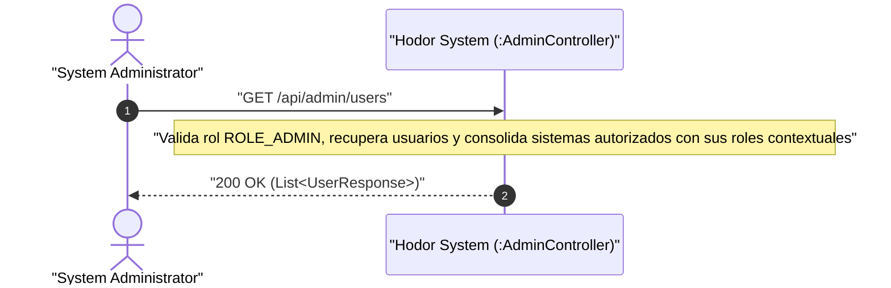
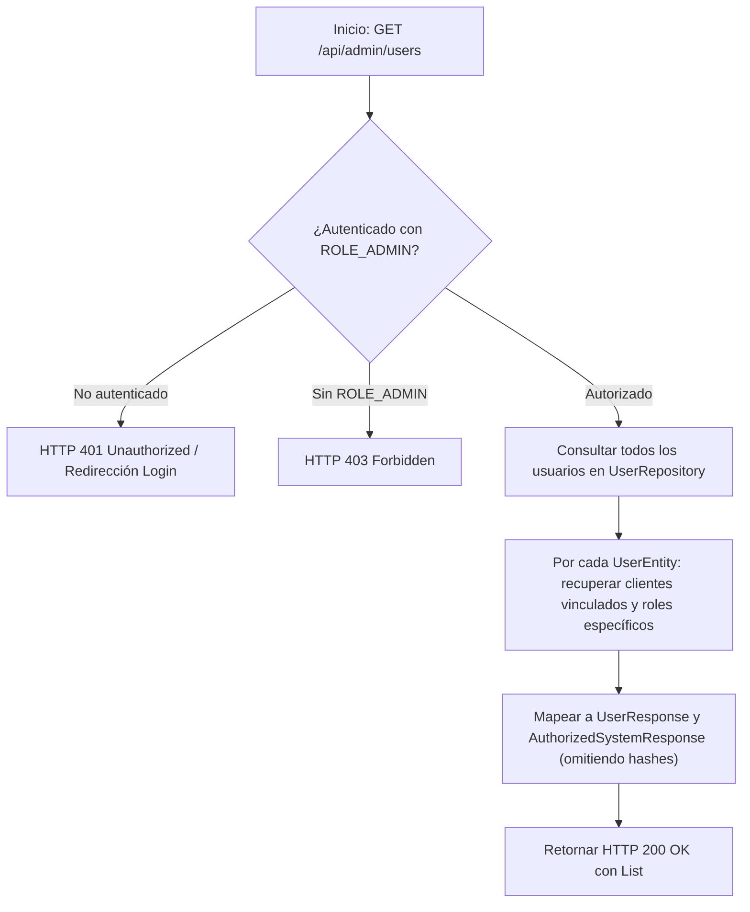

# UC-USER-LIST: Consulta y Listado de Usuarios con Sistemas Autorizados

> **Trazabilidad SDD:** Derivado de `docs/constitution.md` (Sección C "Gestión de Identidad Multi-sistema" y Sección D "Aislamiento de capas de transporte / DTOs").

## 1. Ficha de Intención
- **ID:** `UC-USER-LIST`
- **Actor Principal:** Administrador de Sistemas (`System Administrator` con autoridad `ROLE_ADMIN`).
- **Disparador:** Solicitud HTTP `GET /api/admin/users` recibida en la API administrativa.
- **Precondiciones:**
  - El solicitante debe estar debidamente autenticado y poseer la autoridad `ROLE_ADMIN`.
- **Invariantes de Negocio:**
  - **Proyección Segura de Identidad (Zero Exposure):** Prohibido terminantemente exponer contraseñas, hashes criptográficos, datos sensibles o tokens en la respuesta. Se utiliza exclusivamente el DTO inmutable `UserResponse`.
  - **Agregación Multi-sistema Consolidada:** Para cada usuario registrado, el sistema consolida:
    - Identificador interno (`id` de tipo UUID) y nombre de cuenta (`username`).
    - Estado de habilitación de la cuenta (`enabled`).
    - Colección de autoridades globales del usuario (`authorities`).
    - Lista de sistemas autorizados vinculados (`authorizedSystems`), proyectando para cada cliente sus roles contextuales específicos (`userClientRoleRepository`).
  - **Consistencia de Consulta:** La operación se ejecuta bajo una transacción de sólo lectura (`@Transactional(readOnly = true)`).

## 2. Diagrama de Interacción del Sistema (SSD)

## 3. Árbol de Decisiones

## 4. Caminos Alternativos y Catálogo de Errores

| Código HTTP / Error | Condición Disparadora | Efecto y Respuesta del Sistema |
| :--- | :--- | :--- |
| `401 Unauthorized` | Petición efectuada sin credenciales válidas o con sesión web expirada | Rechazo inmediato de la solicitud o redirección a la pantalla de login |
| `403 Forbidden` | Usuario autenticado que carece de la autoridad `ROLE_ADMIN` | Rechazo con código HTTP 403 Forbidden sin consultar la base de datos |

## 5. Postcondiciones y Efectos Secundarios

- **Estado Persistido:**
  - Ninguno (operación idempotente y de sólo lectura).
- **Eventos Emitidos:**
  - Ninguno.
- **Auditoría:**
  - Registro de invocación del endpoint administrativo en la bitácora del servidor y cómputo de métricas en Spring Boot Actuator.
