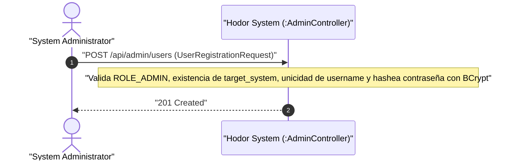
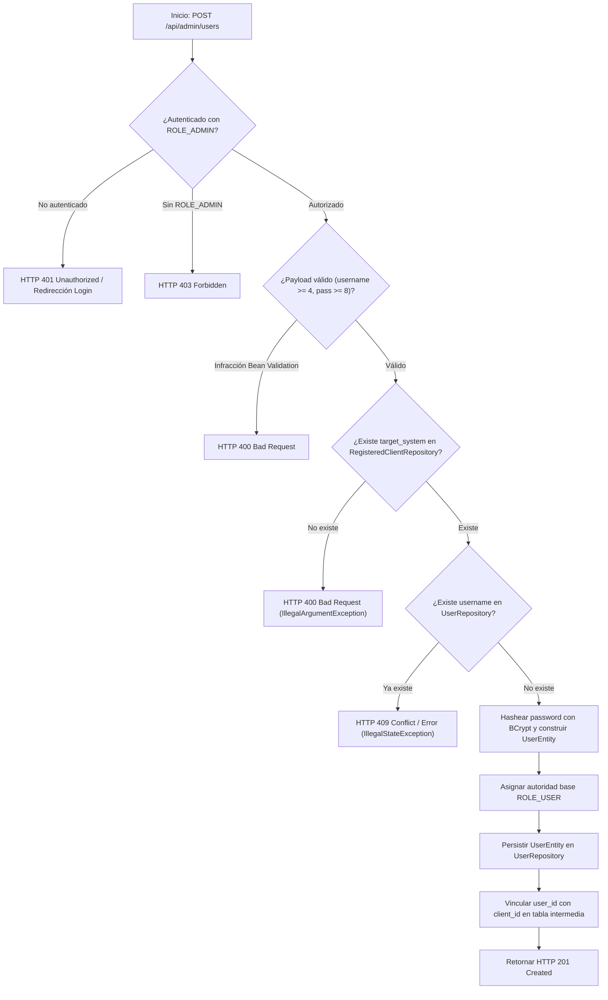

# UC-USER-REGISTER: Registro Administrativo de Usuario para un Sistema

> **Trazabilidad SDD:** Derivado de `docs/constitution.md` (Sección C "Reglas de Dominio", Invariantes "Gestión de Identidad Multi-sistema" y "Almacenamiento Seguro de Contraseñas").

## 1. Ficha de Intención
- **ID:** `UC-USER-REGISTER`
- **Actor Principal:** Administrador de Sistemas (`System Administrator` con autoridad `ROLE_ADMIN`).
- **Disparador:** Solicitud HTTP `POST /api/admin/users` recibida en la API administrativa con payload JSON (`UserRegistrationRequest`).
- **Precondiciones:**
  - El solicitante debe estar autenticado en el sistema y disponer del rol administrativo `ROLE_ADMIN`.
  - El sistema cliente de destino (`target_system`) debe existir previamente registrado en el repositorio de clientes OAuth2 (`RegisteredClientRepository`).
- **Invariantes de Negocio:**
  - **Almacenamiento Seguro de Contraseñas:** Queda terminantemente prohibido almacenar contraseñas en texto plano. La contraseña debe ser procesada obligatoriamente mediante `BCryptPasswordEncoder`.
  - **Unicidad Global de Identidad:** El nombre de usuario (`username`) debe ser único a nivel global dentro del proveedor de identidad. No se permiten duplicados.
  - **Vinculación Multi-sistema Inmediata:** El usuario se crea habilitado (`enabled = true`), se le asigna la autoridad básica por defecto `ROLE_USER` y queda enlazado de inmediato al cliente `target_system` en la tabla relacional intermedia (`user_client`).
  - **Validación Declarativa de Entrada:**
    - `username`: Obligatorio, longitud mínima de 4 y máxima de 50 caracteres no vacíos.
    - `password`: Obligatorio, longitud mínima de 8 caracteres.
    - `target_system`: Obligatorio, identificador de cliente lógico válido.
  - **Transaccionalidad Atómica:** La creación del usuario y la vinculación con el sistema se ejecutan dentro de una frontera transaccional atómica (`@Transactional`).

## 2. Diagrama de Interacción del Sistema (SSD)

## 3. Árbol de Decisiones

## 4. Caminos Alternativos y Catálogo de Errores

| Código HTTP / Error | Condición Disparadora | Efecto y Respuesta del Sistema |
| :--- | :--- | :--- |
| `401 Unauthorized` | Solicitud efectuada sin credenciales válidas o sesión web expirada | Rechazo inmediato de la petición o redirección al formulario de inicio de sesión |
| `403 Forbidden` | Usuario autenticado que carece de la autoridad `ROLE_ADMIN` | Rechazo con código HTTP 403 Forbidden sin consultar la base de datos |
| `400 Bad Request` | Criterios de validación insatisfechos (`username` corto, `password` débil o campos en blanco) | Rechazo con HTTP 400 Bad Request detallando los campos inválidos |
| `400 Bad Request` | El cliente especificado en `target_system` no está registrado en el IdP | Lanzamiento de `IllegalArgumentException` y respuesta con mensaje descriptivo |
| `409 Conflict / Error` | El nombre de usuario provisto ya se encuentra registrado | Lanzamiento de `IllegalStateException` y rechazo de la solicitud para evitar colisión de identidad |

## 5. Postcondiciones y Efectos Secundarios

- **Estado Persistido:**
  - Se inserta un nuevo registro en la tabla de usuarios (`users`) con `password` encriptado con BCrypt y `enabled = true`.
  - Se registra la autoridad `ROLE_USER` asociada al nuevo usuario.
  - Se crea la tupla de relación entre el usuario y el cliente en la tabla intermedia `user_client`.
- **Eventos Emitidos:**
  - Ninguno (operación síncrona transaccional).
- **Auditoría:**
  - Registro en bitácora de la aplicación indicando la creación de la identidad y trazabilidad en métricas de Actuator.
