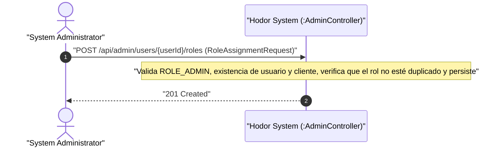
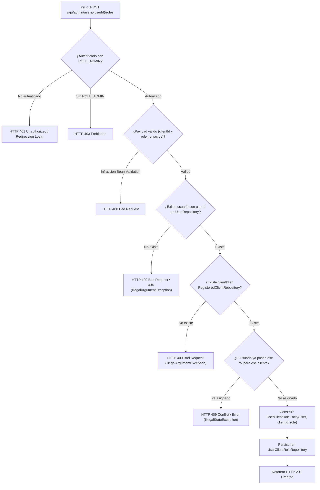

# UC-USER-ROLE-ASSIGN: Asignación de Roles Específicos por Cliente a Usuario

> **Trazabilidad SDD:** Derivado de `docs/constitution.md` (Sección C "Gestión de Identidad Multi-sistema: Autorización delimitada por sistema").

## 1. Ficha de Intención
- **ID:** `UC-USER-ROLE-ASSIGN`
- **Actor Principal:** Administrador de Sistemas (`System Administrator` con autoridad `ROLE_ADMIN`).
- **Disparador:** Solicitud HTTP `POST /api/admin/users/{userId}/roles` con payload JSON (`RoleAssignmentRequest`).
- **Precondiciones:**
  - El solicitante debe estar autenticado en el sistema y disponer del rol administrativo `ROLE_ADMIN`.
  - El usuario con identificador `userId` (UUID) debe existir en la base de datos (`UserRepository`).
  - El cliente OAuth2 (`clientId`) debe existir previamente en el catálogo de clientes (`RegisteredClientRepository`).
- **Invariantes de Negocio:**
  - **Delimitación de Autoridad por Sistema:** Los roles asignados mediante esta operación tienen ámbito exclusivo sobre el cliente indicado (ej. `ROLE_EDITOR` para `blog-client`), sin conferir privilegios en otros sistemas del ecosistema ni actuar como autoridades globales.
  - **Prevención de Duplicidad:** Queda prohibido asignar un mismo rol más de una vez a un usuario dentro del contexto del mismo cliente.
  - **Inyección Automática en Tokens:** Los roles asignados por cliente son consumidos por el componente `JwtTokenCustomizerConfig` para poblar dinámicamente el claim `roles` cuando se emiten access tokens para dicho cliente.
  - **Transaccionalidad Atómica:** La asignación se persiste atómicamente bajo `@Transactional`.
  - **Validación Declarativa:**
    - `clientId`: Obligatorio, no vacío.
    - `role`: Obligatorio, no vacío (ej. `ROLE_AUTHOR`, `ROLE_EDITOR`).

## 2. Diagrama de Interacción del Sistema (SSD)

## 3. Árbol de Decisiones

## 4. Caminos Alternativos y Catálogo de Errores

| Código HTTP / Error | Condición Disparadora | Efecto y Respuesta del Sistema |
| :--- | :--- | :--- |
| `401 Unauthorized` | Petición efectuada sin credenciales válidas o sesión expirada | Rechazo inmediato de la solicitud o redirección a la pantalla de login |
| `403 Forbidden` | Usuario autenticado que carece de la autoridad `ROLE_ADMIN` | Rechazo con código HTTP 403 Forbidden sin consultar la base de datos |
| `400 Bad Request` | Parámetros obligatorios ausentes en el cuerpo de la solicitud | Rechazo con código HTTP 400 Bad Request detallando los campos inválidos |
| `400 Bad Request / 404` | El `userId` especificado en la ruta no existe en la base de datos | Lanzamiento de `IllegalArgumentException` indicando usuario no encontrado |
| `400 Bad Request` | El `clientId` especificado no corresponde a ningún cliente registrado | Lanzamiento de `IllegalArgumentException` indicando cliente no registrado |
| `409 Conflict / Error` | El rol ya está asignado al usuario para ese cliente | Lanzamiento de `IllegalStateException` y rechazo de la asignación para evitar duplicidad |

## 5. Postcondiciones y Efectos Secundarios

- **Estado Persistido:**
  - Se almacena un nuevo registro en la tabla `user_client_roles` asociando `user_id`, `client_id` y `role`.
- **Eventos Emitidos:**
  - Ninguno (operación síncrona transaccional).
- **Efectos en Flujos Posteriores:**
  - En las subsiguientes solicitudes de tokens OAuth2 (`/oauth2/token`) emitidas por este usuario hacia el cliente especificado, el token JWT generado incluirá este rol dentro del claim `roles`.
- **Auditoría:**
  - Registro en bitácora de la aplicación indicando la asignación del rol y trazabilidad en métricas de Actuator.
